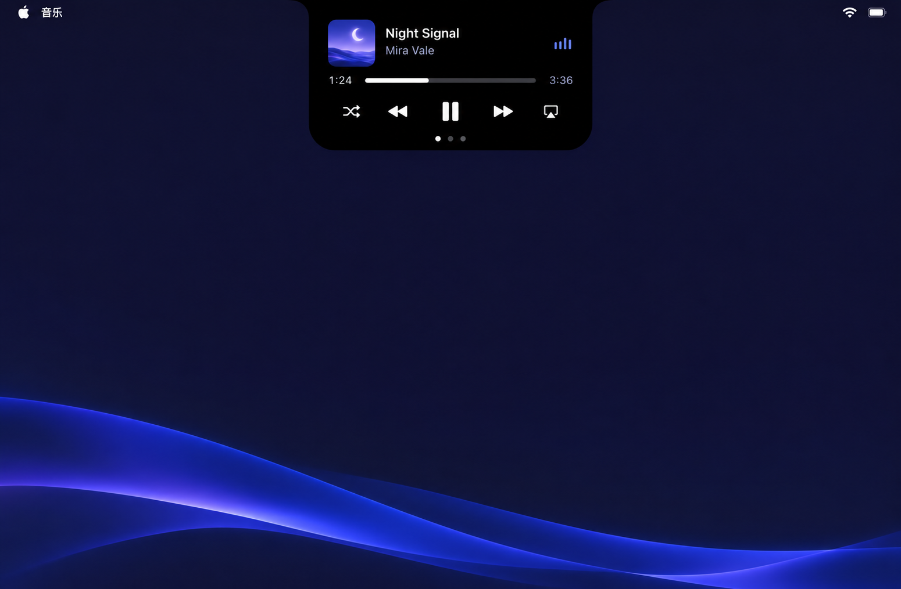

# NotchDay

NotchDay 是为 macOS 26 和带刘海的 MacBook 设计的原生浮岛，使用 SwiftUI 和 AppKit。



- 悬停或点击刘海展开，底部圆点切换音乐、活动与日程。
- 音乐连接系统「音乐」App，支持播放、暂停、上一首、下一首和定位进度。首次连接需要 macOS 自动化授权。
- 日程经授权读取系统日历，显示今天和明天。当日无事件时显示「当天没有日程」，内容超过半屏时启用滚动。
- 活动页打开系统设置的「屏幕时间 → App 与网站活动」报告。
- 锁屏时白锁向左滑出，解锁时向右收回。真实锁屏显示依赖 macOS 私有的 SkyLight 接口，系统更新可能影响可用性。

## 构建和运行

需要 Apple Silicon、macOS 26 或更新版本，以及带 Swift 6.2 或更新版本的 Xcode。

```sh
./Scripts/build-app.sh
open .codex/native-preview/NotchDay.app
```

构建脚本会在项目内生成本地签名的应用。应用常驻时隐藏 Dock 和菜单栏图标。右键刘海打开设置，可以预览白锁或退出应用。

## 设计

- [浏览器交互预览](docs/design/v3/interaction-preview.html)，可下载后在浏览器中打开，使用示例数据。
- [第三版设计图](docs/design/v3)
- 交互参考 [Atoll](https://github.com/Ebullioscopic/Atoll)，锁屏窗口接口参考 [SkyLightWindow](https://github.com/Lakr233/SkyLightWindow)。
