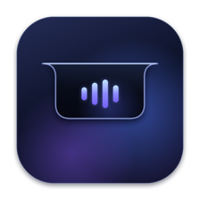
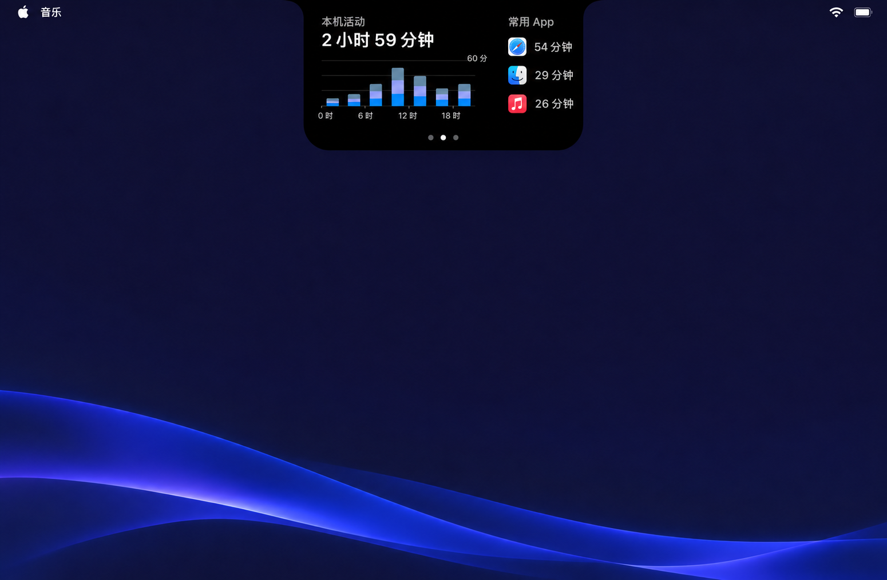
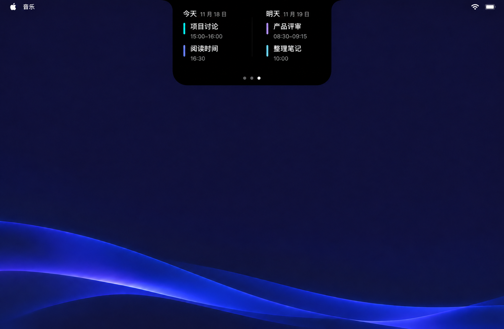
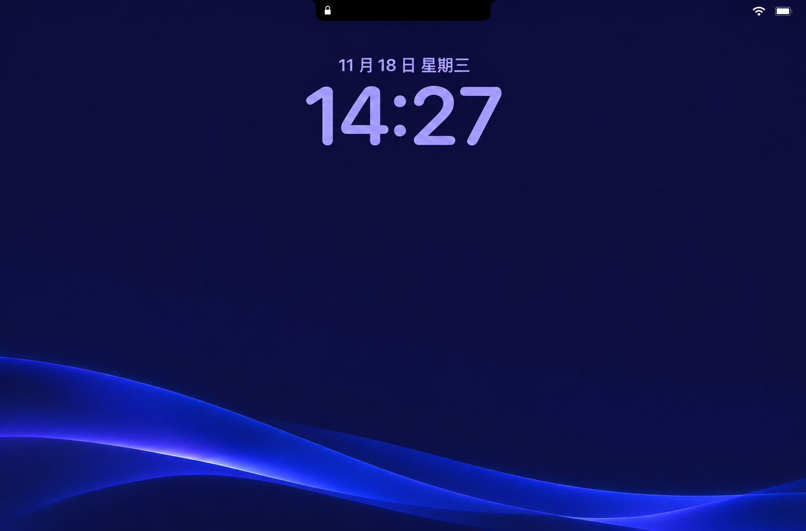

<div align="center">
  
  <h1>NotchDay</h1>
  <p>把 Apple Music、App 与网站活动、日程和提醒事项放进 MacBook 的刘海。</p>
  <p><b>macOS 26+</b> · <b>Apple Silicon</b> · <a href="https://github.com/SaturdayF/NotchDay/releases/latest">下载最新版</a></p>
</div>

## 效果展示

下图为设计预览，使用演示数据。浏览器预览可以体验展开、切页和白锁动画。[打开交互预览源码](docs/design/v3/interaction-preview.html)

<table>
  <tr>
    <td width="50%"><b>Apple Music</b><br></td>
    <td width="50%"><b>App 与网站活动</b><br></td>
  </tr>
  <tr>
    <td><b>今天与明天</b><br></td>
    <td><b>锁屏白锁</b><br></td>
  </tr>
</table>

## 使用

1. 从 [GitHub Releases](https://github.com/SaturdayF/NotchDay/releases) 下载 ZIP，解压后打开 `NotchDay.app`。发布包采用本地临时签名。macOS 如阻止运行，可以按下方步骤从源码本机构建。
2. 将鼠标移到刘海上或点击刘海展开。用左侧圆点或纵向滚轮切换卡片。日程内容超过半屏时，滚轮优先滚动当前日程列表。
3. 右键刘海打开设置，连接系统服务、预览白锁或退出。退出后重新打开 `NotchDay.app` 即可启动。运行时隐藏 Dock 和菜单栏图标。

| 卡片 | 功能 |
| --- | --- |
| **音乐** | 收起时显示封面和四根动态短条。展开后可播放、暂停、切歌、随机播放、拖动进度，以及打开系统声音输出设置。点击曲目区域可打开「音乐」。 |
| **App 与网站活动** | 显示今日总时长、24 小时分布，以及数据库里有记录的 App 和网站用量。点击标题可打开系统屏幕时间报告。 |
| **日程** | 分栏显示今天和明天的日历事件，以及这两天到期的未完成提醒事项。点击行可打开对应的系统 App。 |
| **锁屏与桌面** | 锁屏时，音乐信息淡出后白锁滑入。解锁时锁扣打开，白锁向右收回并淡出。桌面切换沿用同一个灵动岛窗口，并交由 macOS 处理其位置。 |

## 数据和权限

| 功能 | 首次使用 |
| --- | --- |
| Apple Music | 在「系统设置 → 隐私与安全性 → 自动化」允许 NotchDay 控制「音乐」。 |
| 日历、提醒事项 | 在日程卡片分别选择「连接日历」和「连接提醒事项」，按 macOS 提示授权。两种权限可独立授予。 |
| App 与网站活动 | 如果卡片提示无法读取，点「打开完全磁盘访问」并为 NotchDay 授权，再选择「重新读取」。 |

活动页只读查询本机的 `~/Library/Application Support/Knowledge/knowledgeC.db`。它会合并重叠的使用区间，并按本地日历日与小时统计。CoreDuet 数据的字段、记录范围和更新时间由 macOS 决定，因此可能和系统屏幕时间报告有差别。项目在本机读取和汇总这些数据。

## 实现

| 部分 | 方法与框架 |
| --- | --- |
| **界面与窗口** | SwiftUI 绘制卡片、形状和动画，Observation 同步状态。AppKit 的无边框 `NSPanel` 承载桌面界面，按屏幕安全区和刘海两侧区域定位。 |
| **桌面与锁屏** | 监听 macOS 桌面和锁屏状态。运行时加载 SkyLight，为桌面窗口和独立的白锁窗口安排显示；调用不可用时，桌面使用 AppKit 的窗口行为。锁屏显示依赖系统私有接口，macOS 更新可能影响它。 |
| **音乐** | 通过 Apple Events 与系统「音乐」通信。播放通知触发更新，展开音乐页时补充低频校准，动画与进度视图随页面可见性运行。 |
| **日历与提醒事项** | 使用 EventKit 分别请求权限。提醒事项在 EventKit 回调队列中转换成可传递的数据，再在主线程更新卡片。 |
| **使用时间** | 使用 SQLite3 只读打开 CoreDuet 数据库，按版本检测可用字段。查询在后台执行，结果在活动页短时缓存。 |
| **构建与图标** | Swift Package Manager 构建可执行文件，Xcode 的 `actool` 编译 App 图标资源，脚本打包并对本地应用签名。 |

## 从源码构建

需要 Apple Silicon、macOS 26 或更新版本，以及带 Swift 6.2 或更新版本的 Xcode。

```sh
git clone https://github.com/SaturdayF/NotchDay.git
cd NotchDay
./Scripts/build-app.sh
open .codex/native-preview/NotchDay.app
```

交互设计参考 [Atoll](https://github.com/Ebullioscopic/Atoll)。SkyLight 窗口接口参考 [SkyLightWindow](https://github.com/Lakr233/SkyLightWindow)。
